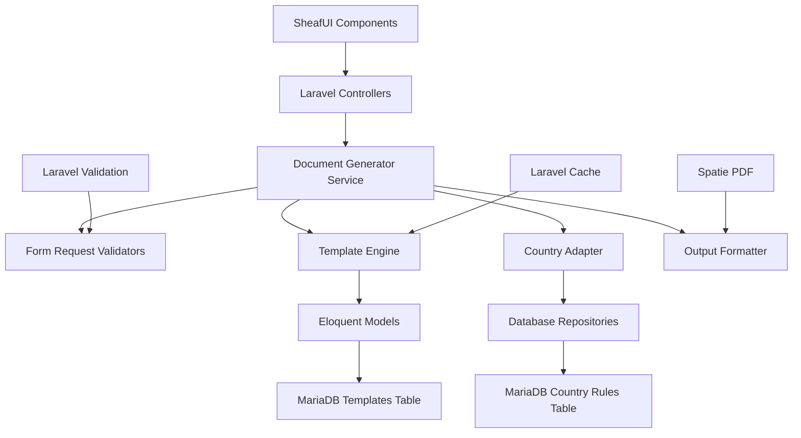

# Design Document: African Administrative Document Generator

## Overview

The African Administrative Document Generator is a Laravel-based web application that generates formal administrative documents for various African countries. The system uses a template-driven approach with strict input validation to produce documents that comply with local administrative conventions while maintaining complete neutrality and accuracy.

The system architecture follows a modular design with clear separation between input processing, template management, country-specific adaptations, and output formatting. This ensures maintainability and allows for easy extension to support additional countries and document types.

## Architecture

The system follows a modern Laravel architecture with SheafUI components:



**Technology Stack:**
- **Frontend**: SheafUI (shadcn/ui) components with Alpine.js
- **Backend**: Laravel 11 with Eloquent ORM
- **Database**: MariaDB with optimized indexing
- **PDF Generation**: Spatie Laravel PDF (DomPDF/Puppeteer)
- **Validation**: Laravel Form Requests with custom rules
- **Caching**: Laravel Cache for templates and country rules
- **Testing**: Pest PHP with custom property-based testing traits

## Components and Interfaces

### DocumentController
**Purpose**: Laravel controller handling HTTP requests for document generation
**Key Methods**:
- `create(): View` - Show document creation form with SheafUI components
- `store(DocumentRequest $request): JsonResponse` - Process document generation
- `preview(DocumentRequest $request): JsonResponse` - Generate preview
- `download(string $id): BinaryFileResponse` - Download generated PDF

### DocumentGeneratorService
**Purpose**: Main service orchestrating document generation
**Key Methods**:
- `generateDocument(DocumentRequest $request): DocumentResult`
- `previewDocument(DocumentRequest $request): string`
- `getSupportedTypes(): Collection`
- `getSupportedCountries(): Collection`

### DocumentRequest (Form Request)
**Purpose**: Laravel Form Request with validation rules
**Key Features**:
- Country-specific validation rules
- Document type field requirements
- Custom validation messages in French
- Sanitization of input data

### TemplateEngine
**Purpose**: Manages Blade templates with caching
**Key Methods**:
- `renderTemplate(DocumentType $type, array $data): string`
- `getTemplate(DocumentType $type): DocumentTemplate`
- `cacheTemplate(string $key, string $content): void`

### CountryAdapter
**Purpose**: Applies country-specific formatting using database rules
**Key Methods**:
- `adaptForCountry(string $content, Country $country): string`
- `getFormattingRules(Country $country): CountryRule`
- `applyPolitenesFormulas(string $content, Country $country, ToneLevel $tone): string`

### OutputFormatter (with Spatie PDF)
**Purpose**: Formats and exports documents to PDF
**Key Methods**:
- `generatePDF(string $content, array $options = []): string`
- `sanitizeForExport(string $content): string`
- `addWatermark(string $pdf, array $options = []): string`

## Data Models

### DocumentRequest (Form Request)
```php
class DocumentRequest extends FormRequest
{
    public function rules(): array
    {
        return [
            'country' => ['required', 'string', Rule::in(Country::cases())],
            'document_type' => ['required', 'string', Rule::in(DocumentType::cases())],
            'tone_level' => ['required', 'string', Rule::in(ToneLevel::cases())],
            'language' => ['required', 'string', 'in:fr,en'],
            'fields' => ['required', 'array'],
            'fields.*' => ['required', 'string', 'max:1000'],
        ];
    }
}
```

### DocumentTemplate (Eloquent Model)
```php
class DocumentTemplate extends Model
{
    protected $fillable = [
        'document_type',
        'country',
        'template_content',
        'required_fields',
        'optional_fields',
        'validation_rules',
        'is_active'
    ];

    protected $casts = [
        'required_fields' => 'array',
        'optional_fields' => 'array',
        'validation_rules' => 'array',
        'is_active' => 'boolean'
    ];
}
```

### CountryRule (Eloquent Model)
```php
class CountryRule extends Model
{
    protected $fillable = [
        'country_code',
        'politeness_formulas',
        'date_format',
        'address_format',
        'administrative_terminology',
        'document_structure_rules'
    ];

    protected $casts = [
        'politeness_formulas' => 'array',
        'administrative_terminology' => 'array',
        'document_structure_rules' => 'array'
    ];
}
```

### GeneratedDocument (Eloquent Model)
```php
class GeneratedDocument extends Model
{
    protected $fillable = [
        'session_id',
        'document_type',
        'country',
        'tone_level',
        'content',
        'pdf_path',
        'metadata',
        'expires_at'
    ];

    protected $casts = [
        'metadata' => 'array',
        'expires_at' => 'datetime'
    ];
}
```

## Correctness Properties

*A property is a characteristic or behavior that should hold true across all valid executions of a system-essentially, a formal statement about what the system should do. Properties serve as the bridge between human-readable specifications and machine-verifiable correctness guarantees.*

Based on the prework analysis, the following properties ensure the system maintains correctness across all valid inputs:

### Property 1: Complete Document Generation
*For any* valid combination of country, document type, tone level, and required fields, the Document Generator should produce a complete administrative document with all required sections.
**Validates: Requirements 1.1**

### Property 2: Data Integrity Preservation
*For any* document generation request, all user-provided data should appear in the output exactly as provided, with no additions, modifications, or omissions of factual information.
**Validates: Requirements 1.2, 8.1, 8.3, 8.4**

### Property 3: Document Structure Consistency
*For any* document type, the generated document should contain all required administrative sections (header, object, body, politeness formula, signature) in the correct order and format.
**Validates: Requirements 1.3, 3.9**

### Property 4: Clean Output Format
*For any* generated document, the output should be free of HTML tags, markdown, formatting codes, and comments, making it ready for PDF/DOCX export.
**Validates: Requirements 1.5, 7.1, 7.2, 7.3**

### Property 5: Comprehensive Validation Behavior
*For any* invalid input (missing required fields or invalid data), the Input Validator should reject the request with explicit error messages and prevent document generation.
**Validates: Requirements 2.1, 2.2, 2.4**

### Property 6: Validation Data Isolation
*For any* validation process, the validator should never add, guess, or complete missing information beyond what was explicitly provided.
**Validates: Requirements 2.3**

### Property 7: Document Type Support
*For any* supported document type (administrative applications, motivation letters, internship requests, honor attestations, complaint letters, administrative act requests, appeal letters, generic correspondence), the system should generate documents with appropriate type-specific structure and sections.
**Validates: Requirements 3.1-3.8**

### Property 8: Tone Consistency
*For any* selected tone level (Simple, Official, Very Official), the generated document should maintain consistent formality throughout while using impersonal and formal language.
**Validates: Requirements 4.1-4.5**

### Property 9: Country Adaptation Integrity
*For any* supported country, the Country Adapter should apply appropriate country-specific formatting conventions while preserving the core meaning and semantic accuracy of the content.
**Validates: Requirements 5.1-5.5**

### Property 10: Content Neutrality
*For any* generated document, the content should remain strictly neutral without legal advice, opinions, legal references, or subjective interpretations.
**Validates: Requirements 6.1-6.5**

### Property 11: Session Data Isolation
*For any* document generation session, no personal information should persist or be cached beyond the completion of the generation process.
**Validates: Requirements 8.2**

### Property 12: Error Message Quality
*For any* processing failure, error messages should be clear and informative without exposing system internals or technical implementation details.
**Validates: Requirements 8.5**

<function_calls>
<invoke name="prework">
<parameter name="featureName">african-admin-document-generator

## Error Handling

The system implements comprehensive error handling at multiple levels:

### Input Validation Errors
- **Missing Required Fields**: Clear identification of which specific fields are missing for the selected document type
- **Invalid Field Format**: Specific validation errors for incorrectly formatted data (dates, names, addresses)
- **Unsupported Combinations**: Errors when country/document type combinations are not supported

### Template Processing Errors
- **Template Not Found**: When a document type template is missing or corrupted
- **Template Rendering Errors**: When template processing fails due to data incompatibility
- **Section Missing Errors**: When required template sections are unavailable

### Country Adaptation Errors
- **Unsupported Country**: When the requested country is not in the supported list
- **Missing Country Rules**: When country-specific formatting rules are unavailable
- **Adaptation Conflicts**: When country rules conflict with document type requirements

### Output Generation Errors
- **Formatting Failures**: When final document formatting encounters issues
- **Export Preparation Errors**: When document cannot be prepared for PDF/DOCX export
- **Content Validation Errors**: When generated content fails final quality checks

**Error Response Format**:
All errors follow a consistent structure with error code, human-readable message, and specific field references where applicable. No system internals or stack traces are exposed to users.

## Testing Strategy

The testing approach combines unit testing for specific scenarios with property-based testing for comprehensive coverage:

### Unit Testing Approach
- **Template Validation**: Test specific document templates with known good and bad inputs
- **Country Rule Application**: Test specific country formatting rules with sample data
- **Error Condition Handling**: Test specific error scenarios and edge cases
- **Integration Points**: Test component interactions and data flow

### Property-Based Testing Approach
- **Comprehensive Input Coverage**: Generate random valid inputs across all supported combinations
- **Data Integrity Verification**: Verify that user data is never modified or invented
- **Format Consistency**: Ensure output format consistency across all generated documents
- **Neutrality Verification**: Verify that no prohibited content appears in any generated document

**Testing Framework**: Pest PHP with custom property-based testing traits and Laravel's built-in testing features.

**Test Configuration**:
- Minimum 100 iterations per property test using custom Pest datasets
- Each property test tagged with: **Feature: african-admin-document-generator, Property {number}: {property_text}**
- Unit tests using Laravel's RefreshDatabase trait for isolated testing
- Property tests using custom generators for comprehensive input coverage
- Integration tests using Laravel's HTTP testing features

**Required Libraries for Testing**:
```php
// composer.json testing dependencies
"pestphp/pest": "^2.0",
"pestphp/pest-plugin-laravel": "^2.0",
"fakerphp/faker": "^1.21",
"spatie/laravel-pdf": "^1.0"
```

**Test Data Management**:
- Database seeders for template and country rule test data
- Factory classes for generating realistic test documents
- Custom Faker providers for African names and addresses
- Cached test templates to improve test performance